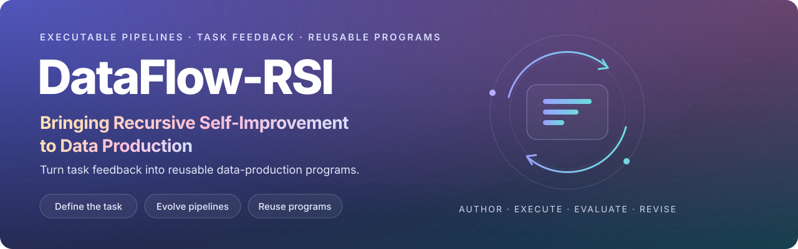

<div align="center">

<a href="https://haolpku.github.io/DataFlow-RSI/">
  
</a>

<br>

[](https://haolpku.github.io/DataFlow-RSI/) [](https://github.com/haolpku/DataFlow-RSI/actions/workflows/validate-contributions.yml) [](LICENSE) [](#join-the-effort)

**Bringing Recursive Self-Improvement to Data Production**

Turn task feedback into reusable data-production programs.<br>
Author, execute, evaluate, and revise data pipelines across tasks.

**[Get started](docs/getting-started.md)** &nbsp; · &nbsp; **[Framework](#pipeline-evolution)** &nbsp; · &nbsp; **[Results](#reported-results)** &nbsp; · &nbsp; **[DataLite-RSI](#datalite-rsi-data-efficient-self-improvement)** &nbsp; · &nbsp; **[Homepage](https://haolpku.github.io/DataFlow-RSI/)**

</div>

---

## Pipeline evolution

**DataFlow-RSI evolves the executable program that produces training data.**
Provide a source corpus, the required output schema, quality criteria, and
feedback sources. A pipeline agent writes or revises operators and their
composition; the framework executes candidates, evaluates their outputs, and
carries task feedback and execution evidence into the next revision.

| Specify the task | Evolve the program | Retain reusable improvements |
| :--- | :--- | :--- |
| Source data, output requirements, evaluation criteria | Generation, verification, selection, and operator structure | Executable pipeline, feedback history, and generated data |

The shared [framework](rsi/framework/README.md) provides operator and pipeline
contracts, execution and repair, candidate selection, checkpoints, and provenance.
Task-specific requirements and evaluators specialize the same evolution loop.
Text review is built in; image and video tasks supply their own operators and
evaluation signals. VideoRSI connects through a router skill and feedback adapter.

- **Define useful supervision:** [task setup](docs/getting-started.md) and [review criteria](docs/review-configuration.md).
- **Connect feedback:** [named feedback sources](docs/feedback-sources.md), execution diagnostics, and optional downstream training.
- **Reuse the resulting program:** inspect its operators, run it on further inputs, and trace the changes that produced each version.

See the [concept](docs/concept.md), [multimodal interfaces](docs/dataflow-multimodal-extension.md),
and [selection policy](docs/selection-policy.md) for the scope of the loop.

## DataLite-RSI: Data-efficient self-improvement

> [!TIP]
> **Research highlight: DataLite-RSI.** Within DataFlow-RSI, we study when better
> selection, synthesis, and pipeline decisions make compact training sets more
> useful. **Less is More for RSI** is a research question explored by the
> reference experiments below.

DataLite-RSI focuses on the final training-data budget. Search, generation,
evaluation, and training exposures are reported separately; a smaller final set
does not by itself establish lower total compute. Read the
[DataLite-RSI concept](docs/concept.md#datalite-rsi-data-efficiency) for the evidence.

### Reference experiments

<table>
<tr>
<th width="33%" align="left">01 &nbsp; Selection</th>
<th width="34%" align="left">02 &nbsp; Synthesis</th>
<th width="33%" align="left">03 &nbsp; Transfer</th>
</tr>
<tr>
<td valign="top">
<strong>Choose useful examples</strong><br><br>
OPSD-Data-Lite selects progressively smaller subsets from a fixed candidate pool.
Its full-pool comparison uses the same reported optimizer-step budget; search adds compute.
<br><br><a href="rsi/methods/opsd-data-lite/">Explore OPSD →</a>
</td>
<td valign="top">
<strong>Improve how data is made</strong><br><br>
Policy-Evolving Edit Synthesis updates instruction policies from batch feedback,
compared with stratified synthesis at the same final pair budget.
<br><br><a href="rsi/methods/policy-evolving-edit-synthesis/">Explore synthesis →</a>
</td>
<td valign="top">
<strong>Test compact-data transfer</strong><br><br>
VideoRSI evaluates one compact SFT dataset across five model families, compared
with their respective base models.
<br><br><a href="rsi/methods/video-rsi/">Explore VideoRSI →</a>
</td>
</tr>
</table>

**Program and corpus refinement.** [DataFlow-Evolver](rsi/methods/dataflow-evolver/)
and [DataFlow-Self-Improver](rsi/methods/dataflow-self-improver/) extend these
perspectives. Evolver improves over base but falls below DataFlow's
expert-authored Math-3K reference; their eight-set and seven-set evaluation means
are not ranked together.

<a id="reported-results"></a>

## Experimental results

**[Explore interactive comparisons ↗](https://haolpku.github.io/DataFlow-RSI/#rs-results)**

These records cover distinct methods and experimental protocols; they are not
a single cross-task leaderboard or a rerun of the current framework.
Each result links to its model settings and evaluation details. Math/video
scores are percentages; image scores are normalized composites. See the
[protocol guide](docs/protocol.md) for comparators and aggregation rules.

<details>
<summary><strong>View the complete result table</strong> — models, protocols and scores</summary>

<!-- results:start -->

| Method / model | Protocol / metric | Base → final |
| --- | --- | --- |
| [OPSD · Qwen3-8B](results/submissions/opsd-data-lite-qwen3-8b/result.json) | 5-set math (%) | 58.70 → 62.10 |
| [Evolver · Qwen2.5-7B](results/submissions/dataflow-evolver-qwen25-7b-math-3k/result.json) | 8-set math (%) | 30.67 → 37.93 |
| [Self-Improver · Qwen3-8B-Base](results/submissions/dataflow-self-improver-qwen3-8b-math-6k/result.json) | 7-set math (%) | 37.11 → 41.45 |
| [Policy synthesis · FLUX](results/submissions/policy-evolving-edit-synthesis-flux2-klein-9b/result.json) | Composite (0–1) | 0.79375 → 0.82400 |
| [Policy synthesis · Qwen Image](results/submissions/policy-evolving-edit-synthesis-qwen-image-edit-2511/result.json) | Composite (0–1) | 0.85010 → 0.86835 |
| [VideoRSI · Qwen3-VL-8B](results/submissions/video-rsi-qwen3-vl-8b-videomme-4p5k/result.json) | Video-MME (%) | 56.56 → 58.89 |
| [VideoRSI · LLaVA-OneVision-7B](results/submissions/video-rsi-llava-onevision-7b-videomme-4p5k/result.json) | Video-MME (%) | 58.52 → 59.48 |
| [VideoRSI · Qwen2.5-VL-3B](results/submissions/video-rsi-qwen25-vl-3b-videomme-4p5k/result.json) | Video-MME (%) | 42.44 → 59.04 |
| [VideoRSI · Gemma-4-E4B](results/submissions/video-rsi-gemma-4-e4b-videomme-4p5k/result.json) | Video-MME (%) | 47.74 → 48.37 |
| [VideoRSI · InternVL3-2B](results/submissions/video-rsi-internvl3-2b-videomme-4p5k/result.json) | Video-MME (%) | 34.85 → 55.22 |

<!-- results:end -->

</details>

Have a method, a new task, or a comparison to add?
[Contribute an experiment](results/README.md) and help extend the research.

## Methods and available materials

| Method | What evolves | Available now |
| --- | --- | --- |
| [**DataFlow-RSI framework**](rsi/framework/README.md) | Executable operators and pipeline structure | Active runtime · task contracts · feedback interfaces · examples |
| [OPSD-Data-Lite](rsi/methods/opsd-data-lite/) | Training subset | Description · config · math evaluation harness |
| [Policy-Evolving Edit Synthesis](rsi/methods/policy-evolving-edit-synthesis/) | Instruction-generation policies | Core loop · rubric tests · environment definition |
| [VideoRSI](rsi/methods/video-rsi/) | Video data pipeline | Description · config · Video-MME evaluation source |
| [DataFlow-Evolver](rsi/methods/dataflow-evolver/) | Data-processing program | Baseline source · reference config · experiment report · grading harness |
| [DataFlow-Self-Improver](rsi/methods/dataflow-self-improver/) | Data pipeline and corpus | Description · config · iteration summaries |

Full reruns still require method-specific source, adapters or artifacts.
The [reproduction guide](docs/reproduction.md#follow-an-original-experiment)
lists what is available and what is missing for each method;
[open evidence gaps](docs/release-gaps.md) track the remaining work.

The active [DataFlow-RSI framework](rsi/framework/README.md) is under
`rsi/framework/`. It supports text and mixed media record pipelines through
one evolution controller. The `rsi/methods/` trees are preserved as method
source and experiment references. VideoRSI provides a router skill and feedback
adapter; the Policy synthesis algorithm remains a separate research reference.

## Quick start

### Run the evolution framework

Python 3.10+. Installing and checking needs no GPU and no model download.

```bash
git clone https://github.com/haolpku/DataFlow-RSI.git
cd DataFlow-RSI
python3 -m venv .venv && source .venv/bin/activate   # Windows: .venv\Scripts\activate
pip install -e ".[review,dev]"
python -c "import rsi.framework; print('ok')"
pytest -q                                            # ~145 passed, offline
```

A run needs three things: a **fixed corpus** (one `.jsonl`/`.json`/`.csv`/`.parquet`
file), a **config** naming your models, and a **task** pointing at both. Then:

```bash
export DF_API_KEY=sk-...          # ReviewAgent
export DF_AGENT_API_KEY=sk-...    # coding agent
export DF_PIPELINE_API_KEY=sk-... # generated-pipeline serving

dataflow-rsi --task my-task.json --run-id my-first-run
```

The original `datalite-rsi` command remains available as a compatibility alias.

One coding-agent backend is installed separately, as a Node CLI — `codex`,
`opencode`, or `claude`. All three are supported equally; `agent.backend` in the
config selects between them.

```bash
npm install -g @openai/codex              # or opencode-ai
                                          # or @anthropic-ai/claude-code
```

**Start here: [Getting started](docs/getting-started.md)** walks through the
install extras, a worked corpus/config/task, where every artifact lands, and how
to read a failure. The [framework README](rsi/framework/README.md) covers the
architecture.

<details>
<summary><strong>Install extras</strong></summary>

| Extra | Adds | Needed for |
| --- | --- | --- |
| *(base)* | pandas, numpy, requests, tqdm, colorlog, PyYAML | importing the runtime, running a generated pipeline |
| `review` | openai | ReviewAgent scoring and embedding quality review |
| `claude` | claude-agent-sdk | the `claude` coding-agent backend |
| `parquet` | pyarrow | `.parquet` entry files or step caches |
| `dev` | pytest, pydantic, Pillow | the repository test suite |

</details>

### Validate contributions and reproduce checks

```bash
pip install -e ".[dev]"
python scripts/validate_contributions.py .
python scripts/run_checks.py
```

<details>
<summary><strong>Preview the project website locally</strong></summary>

```bash
python scripts/build_site.py --check
python -m http.server 8000 --directory _site
```

Open <http://localhost:8000>. The homepage source lives in [`site/`](site/), in
this repository. See the [maintenance guide](site/README.md) for editing and deployment.

</details>

For evaluator fixtures and original experiment requirements, continue with the
[reproduction guide](docs/reproduction.md). Some recorded training commands refer
to upstream implementations that are not yet public.

## Find your way around

| Explore the research | Run and reproduce | Extend the collection |
| --- | --- | --- |
| [Concept & scope](docs/concept.md) | [**Getting started**](docs/getting-started.md) | [Contribution guide](CONTRIBUTING.md) |
| [Result records](results/) | [Framework README](rsi/framework/README.md) | [Manifest schemas](schemas/) |
| [Method packages](rsi/methods/) | [Reproduction guide](docs/reproduction.md) | [Copyable templates](templates/) |
| [Evaluation protocols](docs/protocol.md) | [Runtime parity audit](docs/dataflow-serving-parity.md) | [中文贡献指南](docs/CONTRIBUTING_zh.md) |
| [Multimodal boundary](docs/dataflow-multimodal-extension.md) | [Runnable examples](examples/) | [Dataset registry](datasets/) |
| [Result manifests](results/submissions/) | [Evaluation harnesses](evaluation/) | [Docker environments](docker/) |

<details>
<summary><strong>Repository map</strong></summary>

```text
DataFlow-RSI/
├── rsi/framework/  Active evolution runtime (the installable package)
├── rsi/methods/    Method source and experiment references
├── docs/         Getting started, concept, protocols, parity audit
├── examples/     Runnable configuration and harness examples
├── site/         Project homepage source
├── results/      Experiment records and result summaries
├── benchmarks/  Suite definitions, evaluators and fixtures
├── datasets/    Dataset metadata and pinned references
├── evaluation/  Shared and vendored evaluation harnesses
├── docker/      Evaluation environment definitions
├── schemas/     Machine-readable contribution contracts
├── templates/   Starting points for new contributions
└── scripts/     Validation, offline checks and website generation
```

</details>

## Join the effort

We invite researchers, engineers, and practitioners to improve **recursive
self-improvement for data production**. Bring a task, evaluator, pipeline,
reproduction, or research question. DataLite-RSI contributions on data efficiency
are welcome alongside work on pipeline quality, feedback, and generalization.

| Bring your perspective | A useful starting point |
| --- | --- |
| **Ask a research question** | How can feedback improve the program that produces useful supervision? [Open an issue](https://github.com/haolpku/DataFlow-RSI/issues). |
| **Explore a new method or task** | Study selection, synthesis, refinement, or another feedback mechanism in a new setting. |
| **Strengthen the evidence** | Reproduce a result, add matched-budget controls, measure total cost, or report a negative result. |
| **Make experiments easier to compare** | Contribute evaluators, datasets, reproducible configurations, or clearer protocols. |

Bring a **[benchmark](benchmarks/README.md)**, **[dataset](datasets/README.md)**,
**[result](results/README.md)**, or **[RSI method](rsi/README.md)**.
Reproductions, stronger controls, and well-documented negative results are useful
contributions. Start with [CONTRIBUTING.md](CONTRIBUTING.md).

<details>
<summary><strong>Maintaining results and storing artifacts</strong></summary>

Update scores in `results/submissions/*/result.json`, then run
`python scripts/build_site.py` to refresh the result table. The homepage reads
those same manifests; CI rejects a stale generated README table.

Keep code, manifests, docs and website source in GitHub. Store large datasets and
model artifacts externally; the current dataset hub is
[Lite-RSI on Hugging Face](https://huggingface.co/datasets/lhpku20010120/Lite-RSI).
Do not commit model weights, generated media, secrets, or dataset archives.

</details>

<details>
<summary><strong>Citation and licensing</strong></summary>

Paper and citation metadata are pending. Refer to this repository and a commit
when discussing the current collection.

This repository is licensed under [Apache License 2.0](LICENSE). Individual
method manifests under `rsi/methods/` may still declare `NOASSERTION` where the
upstream source they mirror carries no license of its own; those trees are
research references, not part of the installable runtime. Vendored components
retain their own license notices.

</details>

---

<div align="center">

**Build better data-production programs through feedback.**<br>[Explore DataFlow-RSI ↗](https://haolpku.github.io/DataFlow-RSI/)

</div>
